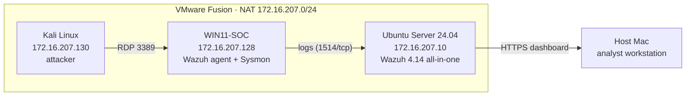

# Home SOC Lab – Wazuh, Sysmon & Attack Detection

A small Security Operations Center built on a laptop to practice the SOC analyst workflow:
a monitored Windows endpoint, a Wazuh SIEM collecting its logs, and a Kali machine attacking it.

**First scenario:** an RDP brute-force from Kali, detected by Wazuh as a level 10 correlation alert
(MITRE ATT&CK **T1110 – Brute Force**). The focus is the defender side: see the alert, understand it, trace it back.

---

## Architecture



| VM | OS | Role | IP |
| --- | --- | --- | --- |
| wazuh-server | Ubuntu Server 24.04 ARM | SIEM (indexer, manager, dashboard) | 172.16.207.10 (static) |
| WIN11-SOC | Windows 11 ARM | Monitored endpoint | 172.16.207.128 |
| kali-attacker | Kali Linux 2026.2 ARM | Attacker | 172.16.207.130 |

Host: MacBook Air M5 (16 GB), VMware Fusion.

---

## Setup

1. **Wazuh 4.14.8** installed all-in-one on Ubuntu:
   ```bash
   curl -sO https://packages.wazuh.com/4.14/wazuh-install.sh
   sudo bash wazuh-install.sh -a
   ```
2. **Static IP** for the server with netplan (cloud-init network config disabled so it is not overwritten):
   ```bash
   echo "network: {config: disabled}" | sudo tee /etc/cloud/cloud.cfg.d/99-disable-network-config.cfg
   sudo netplan apply
   ```
3. **Admin password** changed with `wazuh-passwords-tool.sh`, Filebeat checked with `filebeat test output`.
4. **Wazuh agent** on Windows (PowerShell as admin):
   ```powershell
   Invoke-WebRequest -Uri https://packages.wazuh.com/4.x/windows/wazuh-agent-4.14.8-1.msi -OutFile $env:tmp\wazuh-agent.msi
   msiexec.exe /i $env:tmp\wazuh-agent.msi /q WAZUH_MANAGER='172.16.207.10' WAZUH_AGENT_NAME='WIN11-SOC'
   NET START Wazuh
   ```
5. **Sysmon** with the [SwiftOnSecurity config](https://github.com/SwiftOnSecurity/sysmon-config) (`Sysmon64a.exe` for ARM64),
   and the Sysmon channel added to the agent's `ossec.conf`:
   ```xml
   <localfile>
     <location>Microsoft-Windows-Sysmon/Operational</location>
     <log_format>eventchannel</log_format>
   </localfile>
   ```
6. **Snapshots** taken at every stable step, so any mistake can be rolled back in seconds.

---

## Scenario 1 – RDP brute-force detection

| Step | Action | Result |
| --- | --- | --- |
| 1. Recon | `nmap 172.16.207.128` from Kali | All ports `filtered` (Windows firewall) |
| 2. Prepare target | Enable RDP (`fDenyTSConnections = 0`), enable firewall rules, reboot | `3389/tcp open` |
| 3. Single attempt | `hydra -l analyst -p <wrong> rdp://172.16.207.128` | 1 × Event ID 4625 → Wazuh rule 60122 (level 5) |
| 4. Brute-force | Bash loop with `xfreerdp +auth-only` over a 10-password wordlist | 10 × Event ID 4625 |
| 5. Detection | Wazuh correlation | Rule **60204 "Multiple Windows Logon Failures"**, level 10, **T1110** |

Brute-force loop used (hydra's RDP module was unstable on this setup):

```bash
while read pw; do
  xfreerdp /v:172.16.207.128 /u:analyst /p:"$pw" +auth-only /cert:ignore
done < passwords.txt
```

### What the alert shows

| Field | Value |
| --- | --- |
| Windows event | 4625 (failed logon) |
| Sub-status | `0xC000006A` (wrong password, existing account) |
| Target account | `analyst` |
| Source IP | `172.16.207.130` (Kali) |
| Atomic rule | 60122, level 5 – one failure is noise |
| Correlation rule | 60204, level 10 – the pattern is the signal |
| MITRE ATT&CK | T1110 Brute Force |

The key SOC point: a single failure is noise; it's the **repetition from one source** that makes an actionable alert.

---

## Scenario 2 – SSH brute-force with automatic response (Active Response)

Same detection logic as Scenario 1, but this time the target is the **Linux server itself** (SSH, port 22),
and Wazuh does not just detect — it **blocks the attacker automatically**.

| Step | Action | Result |
| --- | --- | --- |
| 1. Arm defense | Add an Active Response block to the manager's `ossec.conf` (`firewall-drop` on rule `5763`, 180s) | Wazuh will auto-ban any SSH brute-force source |
| 2. Recon | `nmap 172.16.207.10` from Kali | `22/tcp open ssh` |
| 3. Wordlist | 10 fake passwords in `passwords.txt` | — |
| 4. Brute-force | `hydra -l socadmin -P passwords.txt -t 4 ssh://172.16.207.10` | 11 failed SSH logins, `0 valid password found` |
| 5. Detection | Wazuh correlation on `/var/log/auth.log` | Rule **5763** "sshd: brute force", level 10, **T1110** |
| 6. Response | `firewall-drop` Active Response | Kali's IP `172.16.207.130` banned for 180s |

Active Response block added to `/var/ossec/etc/ossec.conf`:

```xml
<active-response>
  <command>firewall-drop</command>
  <location>local</location>
  <rules_id>5763</rules_id>
  <timeout>180</timeout>
</active-response>
```

Proof in `/var/ossec/logs/active-responses.log`:

```
active-response/bin/firewall-drop: {"command":"add", ...
  "srcip":"172.16.207.130",
  "rule":{"id":"5763","level":10,
          "description":"sshd: brute force trying to get access to the system",
          "mitre":{"id":["T1110"],"technique":["Brute Force"]}}}
```

This closes the loop: **detect → respond**. The lab now blocks an attacker automatically, not just alerts on it.

> Note during setup: the SSH brute-force fires Wazuh rule **5763** (not the older `5712`), so the Active
> Response must reference `5763`. Confirmed by reading the alert in `alerts.log` before wiring the response.

---

## Troubleshooting notes

| Problem | Cause | Fix |
| --- | --- | --- |
| Port 3389 still `filtered` after enabling RDP | Service "Running" but no listener (`Get-NetTCPConnection`) | Full reboot of the Windows VM |
| Hydra RDP module fails (`freerdp: connection failed`) | Unstable module on this setup | Loop with `xfreerdp +auth-only` |
| Agent kept the old manager IP | `ossec.conf` is read only at start | Edit `ossec.conf`, `Restart-Service WazuhSvc` |
| Wazuh rejected the new password | Allowed symbols are limited to `.*+?-` | Compliant password |

**Main lesson:** service, firewall and listener are three separate layers. A port can be allowed in the
firewall with the service running, and still nothing is actually listening.

---

## Roadmap

- [x] SSH brute-force against the Ubuntu server (Scenario 2)
- [x] Active Response: block the attacker IP automatically (Scenario 2)
- [ ] Account lockout (Event ID 4740)
- [ ] Custom Wazuh rule for RDP brute-force
- [ ] Python script to enrich alerts (IP reputation via AbuseIPDB)
